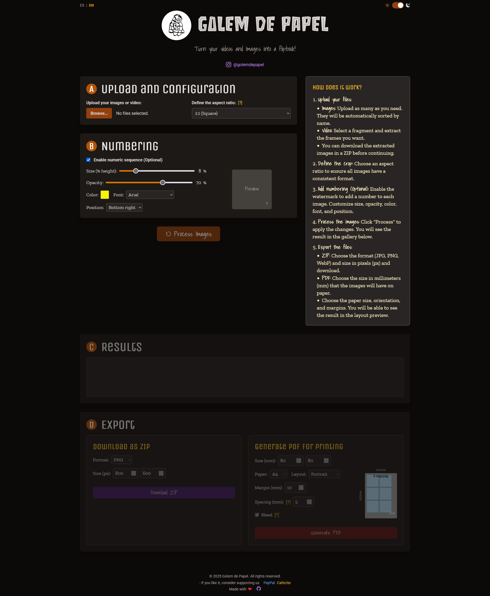

# 🌐 Golem de Papel
*Web app for mechanical flipbook preparation*

---

## 📍 🔗 **[Online site](https://ramamc.github.io/Golem/)**

---

## 📖 Description

Lightweight web application to prepare images for building mechanical flipbooks.
It allows users to load images or videos, edit them, and export ready-to-print layouts. 

---

## 🚀 Key Features

- Import images or extract frames from video 
- Crop, scale, and aspect-ratio adjustment tools 
- Sequence organization for flipbook construction 
- PDF export with cut marks 
- Optional ZIP package download 
- Runs locally in the browser, no server required 

---

## 📜 License
© 2025 Golem de Papel. All rights reserved.

